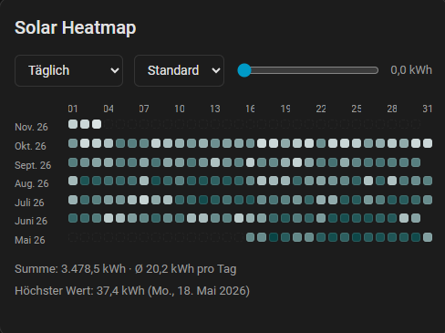

# Solar Heatmap Card

A Home Assistant dashboard card that shows your solar (PV) energy yield as a heatmap — per hour, day, week, month or year. A slider hides everything below a minimum value, so your best days stand out immediately.

> Ein Heatmap-Karte für Home Assistant, die den Solarertrag pro Stunde, Tag, Woche, Monat oder Jahr zeigt. Ein Schieberegler blendet alles unter einem Mindestwert aus, damit die besten Tage sofort auffallen. Deutsche Anleitung weiter unten.



## Features

- Five views: hourly, daily, weekly, monthly, yearly
- The highest value is always the darkest colour
- Slider for a minimum value: everything below turns white
- Period dropdown that only offers years / months for which data exists
- Summary under the grid: total, average and best value
- Click or hover a cell for its date and value
- Visual editor, everything also configurable in YAML
- Base colour freely selectable

> **Note:** The card's interface text is currently German only.

## Views

| View | One cell is | Grid |
|---|---|---|
| `hourly` | 1 hour | days × hours 0–23 |
| `daily` | 1 day | months × days 1–31 |
| `weekly` | 1 day | calendar weeks × Mon–Sun |
| `monthly` | 1 month | years × months |
| `yearly` | 1 year | one cell per year with the yearly total |

## Requirements

The card reads Home Assistant's **long-term statistics**. Your sensor needs a `state_class` (`total`, `total_increasing` or `measurement`). Best suited is a continuously increasing energy sensor in kWh (for example a Riemann sum / integration sensor or an energy counter). You can check that the sensor has statistics under *Developer tools → Statistics*.

## Installation

### HACS (custom repository)

1. HACS → ⋮ → *Custom repositories*
2. Add `https://github.com/Takifighter/lovelace-solar-heatmap` as type **Dashboard**
3. Install *Solar Heatmap* and reload the browser (Ctrl+F5)

### Manual

1. Copy `solar-heatmap.js` to `/config/www/`
2. *Settings → Dashboards → ⋮ → Resources* → add `/local/solar-heatmap.js` as *JavaScript module*
3. Reload the browser (Ctrl+F5)

## Configuration

Add the card through the UI (*Solar Heatmap*) or in YAML:

```yaml
type: custom:solar-heatmap
entity: sensor.solar_energy_total
title: Solar yield
view: daily
```

| Option | Default | Description |
|---|---|---|
| `entity` | required | Energy sensor with long-term statistics |
| `title` | none | Card title; hidden when empty |
| `view` | `daily` | `hourly`, `daily`, `weekly`, `monthly`, `yearly` |
| `color` | `#34c776` | Base colour (hex) |
| `below_color` | `#ffffff` | Colour of cells below the minimum value |
| `decimals` | `1` | Decimal places |
| `unit` | from sensor | Unit shown, e.g. `kWh` |
| `rows` | per view | Rows in the *Standard* view (hourly 21, daily 12, weekly 20, monthly 5, yearly 10) |
| `max` | highest value | Fixed upper end of the colour scale |
| `stat` | `auto` | `auto`, `change`, `max`, `mean`, `sum` — see below |
| `newest_first` | `false` | Newest row on top |
| `show_view_select` | `true` | Show the view dropdown in the card |

### The `stat` option

Leave it on `auto`. For counters that keep increasing the card uses the change per period, which is the yield. Switch to `max` or `mean` only for sensors that report an instantaneous value (e.g. power in W).

## Troubleshooting

- **Everything empty:** the sensor has no long-term statistics. Check *Developer tools → Statistics*.
- **Odd values:** try `stat: change`.
- **Day boundaries:** days follow your browser's time zone.

## License

MIT

---

# Deutsch

Heatmap-Karte für den Solarertrag. Fünf Ansichten (stündlich, täglich, wöchentlich, monatlich, jährlich), ein Regler für den Mindestwert (alles darunter wird weiß) und eine Zusammenfassung mit Summe, Durchschnitt und Höchstwert.

## Voraussetzung

Die Karte liest die **Langzeitstatistiken**. Der Sensor braucht eine `state_class`. Am besten geeignet ist ein fortlaufender Energiesensor in kWh, zum Beispiel ein Riemann-Summensensor. Unter *Entwicklerwerkzeuge → Statistiken* siehst du, ob der Sensor dort steht.

## Installation

1. HACS → ⋮ → *Benutzerdefinierte Repositories*
2. `https://github.com/Takifighter/lovelace-solar-heatmap` als Typ **Dashboard** hinzufügen
3. *Solar Heatmap* installieren, Browser neu laden (Strg+F5)

Danach die Karte über die Oberfläche hinzufügen, den Sensor wählen und die Ansicht festlegen.

## Hinweise

- Alles bleibt leer: Der Sensor hat keine Langzeitstatistik.
- Seltsame Werte: im Editor „Wert pro Zeitraum“ auf *Änderung (change)* stellen.
- Die Tagesgrenzen richten sich nach der Zeitzone deines Browsers.
